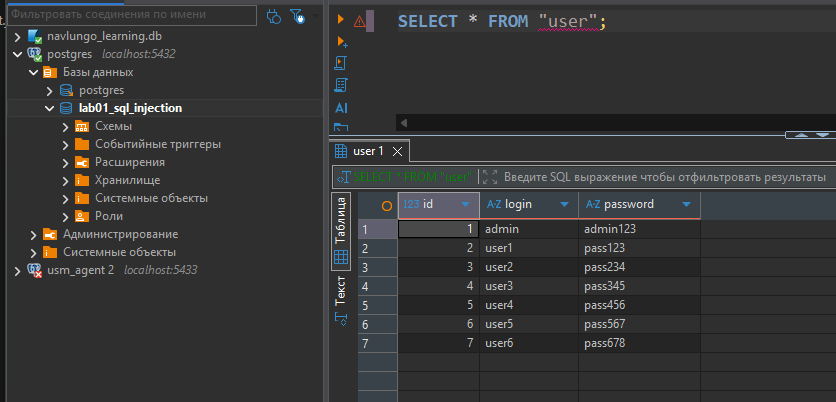
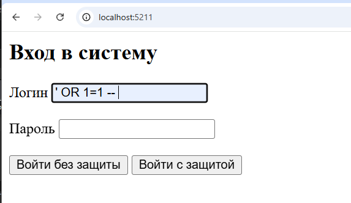
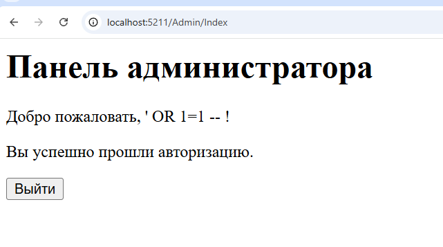
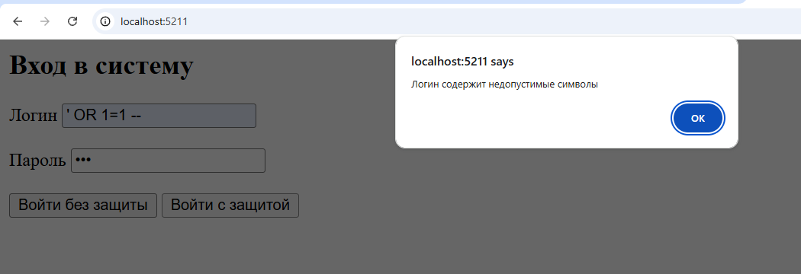
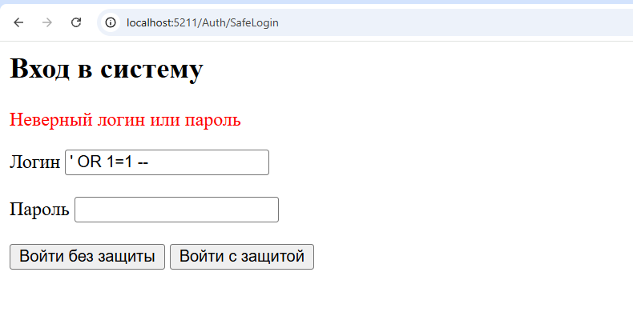

# Лабораторная работа №2 — SQL Injection

**Тема:** Методы предотвращения SQL Injection в веб-приложениях.

## 1. Запуск проекта

1. Создать в PostgreSQL базу данных `sql_injection_lab`.
2. Создать таблицу `user` и добавить 7 пользователей.
3. Создать файл `appsettings.json` в корне проекта на основе примера:

```json
{
  "ConnectionStrings": {
    "DefaultConnection": "Host=localhost;Port=5432;Database=sql_injection_lab;Username=postgres;Password=<пароль>"
  },
  "Logging": {
    "LogLevel": {
      "Default": "Information",
      "Microsoft.AspNetCore": "Warning"
    }
  },
  "AllowedHosts": "*"
}
```

4. В терминале выполнить:

```bash
dotnet restore
dotnet run
```

## 2. В базе данных выполнены следующие скрипты:

Создана таблица `user`:

```sql
CREATE TABLE public."user" (
    id SERIAL PRIMARY KEY,
    login VARCHAR(50) NOT NULL UNIQUE,
    password VARCHAR(100) NOT NULL
);
```

Добавлено семь тестовых пользователей. Для демонстрации пароли хранятся в открытом виде.

```sql
INSERT INTO public."user" (login, password)
VALUES
('admin', 'admin123'),
('user1', 'pass123'),
('user2', 'pass234'),
('user3', 'pass345'),
('user4', 'pass456'),
('user5', 'pass567'),
('user6', 'pass678');
```

**Результат:**




## 3. Уязвимая авторизация (Vulnerable Login)

Пользователь вводит логин и пароль. Форма отправляет их POST-запросом в метод `VulnerableLogin` контроллера `AuthController`.

В методе SQL-запрос формируется следующим образом:

```csharp
string sql =
    $"SELECT id FROM public.\"user\" " +
    $"WHERE login = '{model.Login}' " +
    $"AND password = '{model.Password}'";
```

**Проблема:** логин и пароль напрямую вставляются в SQL-запрос. Поэтому пользователь может ввести SQL-код вместо обычного значения и изменить условие запроса.



Для проверки SQL-инъекции вводим:

```text
Login: ' OR 1=1 --
Password: 
```

После этого запрос содержит условие `OR 1=1`, которое всегда истинно, а `--` комментирует оставшуюся часть запроса.

В результате приложение разрешает вход без правильного пароля.



## 4. Защищённая авторизация (Safe Login)

Для защиты реализованы проверки на стороне клиента и сервера.

### 4.1. Client-side проверка

В JavaScript проверяем заполненность полей и длину введённых данных:

```javascript
if (!login.trim() || !password) {
    alert("Заполните все поля");
    return false;
}

if (login.length > 50 || password.length > 100) {
    alert("Слишком длинные данные");
    return false;
}
```

Эта проверка помогает избежать некорректного ввода, но её можно обойти. Поэтому она не является основной защитой от SQL-инъекций.



### 4.2. Server-side защита

В методе `SafeLogin` используются параметризованные SQL-запросы:

```csharp
string sql =
    "SELECT id FROM public.\"user\" " +
    "WHERE login = $1 AND password = $2";

await using var command =
    new NpgsqlCommand(sql, connection);

command.Parameters.Add(
    new NpgsqlParameter { Value = model.Login });

command.Parameters.Add(
    new NpgsqlParameter { Value = model.Password });

var result = await command.ExecuteScalarAsync();
```

В отличие от уязвимого метода, логин и пароль передаются отдельно от SQL-кода через параметры `$1` и `$2`.

Поэтому PostgreSQL воспринимает введённую строку как обычные данные, а не как SQL-команду.

При повторной попытке SQL-инъекции авторизация не проходит.




