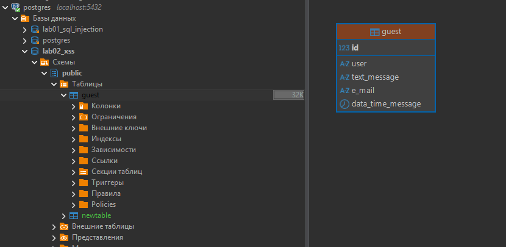
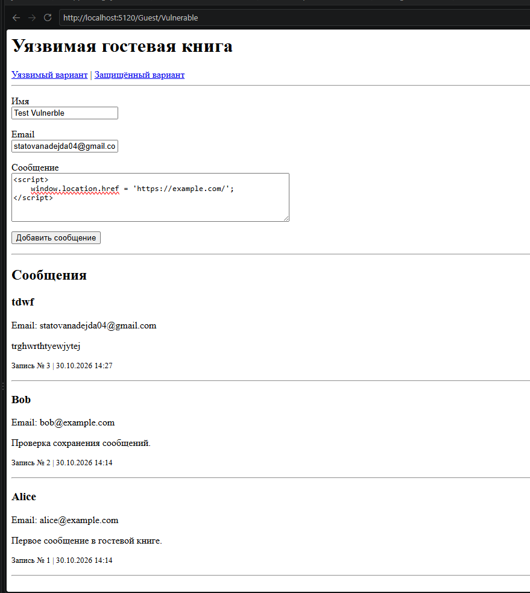
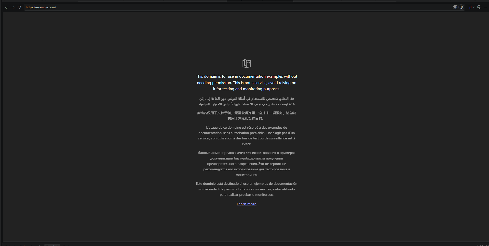
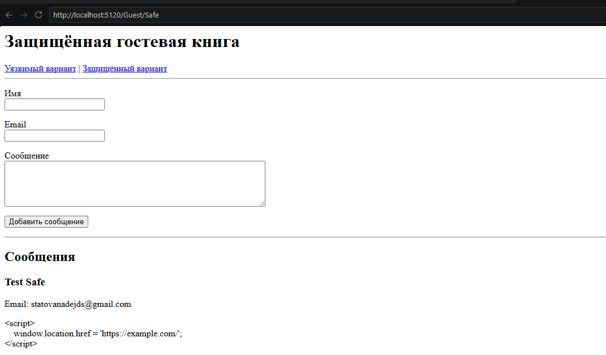

# Лабораторная работа №2 — XSS

**Тема:** Предотвращение XSS-атак в веб-приложениях.

## 1. Запуск проекта

1. Создать базу `guest` и таблицу по скрипту ниже.
2. В `appsettings.json` указать подключение к PostgreSQL:

```json
{
  "ConnectionStrings": {
    "DefaultConnection": "Host=localhost;Port=5432;Database=guest;Username=postgres;Password=<пароль>"
  }
}
```

3. В терминале проекта выполнить:

```bash
dotnet restore
dotnet run
```

4. Открыть адрес из `Now listening on`, добавив:
   - `/Guest/Vulnerable` — уязвимый вариант;
   - `/Guest/Safe` — защищённый вариант.

## 2. База данных

База создаётся отдельной командой:

```sql
CREATE DATABASE guest;
```

После подключения к базе `guest` создаётся таблица:

```sql
CREATE TABLE public.guest (
    id integer GENERATED BY DEFAULT AS IDENTITY PRIMARY KEY,
    "user" varchar(100) NOT NULL,
    text_message varchar(2000) NOT NULL,
    e_mail varchar(200) NOT NULL,
    data_time_message timestamp with time zone NOT NULL
);
```

В таблице хранятся имя, сообщение, email и время отправки.



## 3. Сохранение сообщений

Данные формы сохраняются через EF Core:

```csharp
entry.DataTimeMessage = DateTime.UtcNow;
_db.Entries.Add(entry);
await _db.SaveChangesAsync();
```

Оба варианта страницы используют одну таблицу и отображают одинаковые записи.

## 4. Уязвимый вариант

В `Vulnerable.cshtml` данные выводятся через `Html.Raw`:

```cshtml
<h3>@Html.Raw(entry.User)</h3>
<p>@Html.Raw(entry.Email)</p>
<div>@Html.Raw(entry.TextMessage)</div>
```

`Html.Raw` отключает HTML-кодирование. Поэтому введённый JavaScript может выполниться в браузере.

Для проверки в поле сообщения вводится код перенаправления:

```html
<script>
    window.location.href = 'https://example.com/';
</script>
```



После сохранения сообщения скрипт выполняется при отображении записи и перенаправляет браузер на другой сайт.

Это сохранённый XSS: внедрённый код хранится в БД и выполняется при просмотре страницы.



## 5. Защищённый вариант

В `Safe.cshtml` используется обычный вывод Razor:

```cshtml
<h3>@entry.User</h3>
<p>@entry.Email</p>
<div>@entry.TextMessage</div>
```

Razor кодирует специальные HTML-символы. Поэтому введённые теги отображаются как текст, а скрипт не выполняется.

При открытии `/Guest/Safe` та же запись выводится без перенаправления.



Дополнительно на клиенте проверяется заполненность полей:

```javascript
if (!user.trim() || !message.trim()) {
    event.preventDefault();
    error.textContent =
        'Имя и сообщение не должны состоять из пробелов.';
}
```

На сервере проверяется корректность модели:

```csharp
if (!ModelState.IsValid)
{
    return View(viewName, await GetEntries());
}
```

Проверки формы отвечают за корректность данных. Основная защита от XSS в представлениях — HTML-кодирование пользовательских значений вместо вывода через `Html.Raw`.